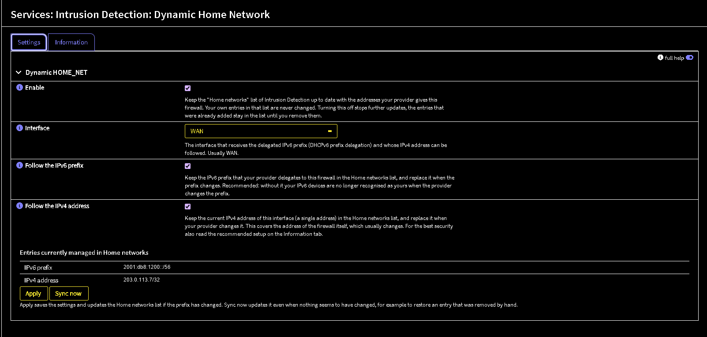
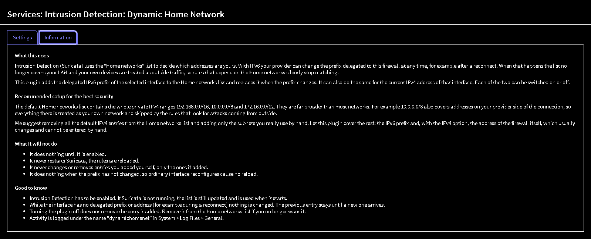
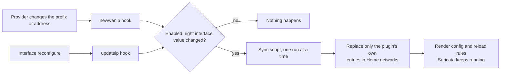

<h1 align="center">os-dynamichomenet</h1>

<p align="center">
  <b>Keep Suricata's Home networks in step with the addresses your provider gives your firewall.</b>
</p>

<p align="center">
  <a href="security/dynamic-homenet/pkg-descr"></a>
  <a href="https://opnsense.org"></a>
  <a href="LICENSE"></a>
</p>

An OPNsense plugin that automatically keeps the **Home networks** (`HOME_NET`) list of Intrusion Detection
(Suricata) current with your delegated **IPv6 prefix** and, optionally, your **IPv4 WAN address**. When your
provider renumbers you, the list follows, and Suricata keeps recognising your network as yours.

**Contents:** [Why](#why-this-exists) · [Features](#features) · [Screenshots](#screenshots) · [Requirements](#requirements) ·
[Installation](#installation) · [Configuration](#configuration) · [Recommended setup](#recommended-setup) ·
[Usage](#usage) · [How it works](#how-it-works) · [FAQ](#faq) · [Troubleshooting](#troubleshooting) ·
[Uninstall](#uninstall) · [Development](#development) · [License](#license)

---

## Why this exists

Suricata decides which addresses are "yours" from the Home networks list, and many rules only match traffic
to or from `HOME_NET`.

- **IPv6.** Providers that use DHCPv6 prefix delegation can hand you a different prefix at any time, for
  example after a reconnect. If the list does not follow, your whole IPv6 network is treated as outside
  traffic and those rules silently stop matching. Nothing warns you.
- **IPv4.** Some providers give the WAN a private address that is not covered by your Home networks and
  changes from time to time. The firewall itself then falls outside `HOME_NET`, and rules aimed at it stop
  matching.

This plugin watches for those changes and updates the list for you.

## Features

- **Follows the IPv6 prefix.** The delegated prefix of the chosen interface is added to Home networks and
  replaced when it changes. If your provider delegates several prefixes, all of them are kept.
- **Optionally follows the IPv4 address.** The current WAN address is kept as a single `/32` entry.
- **Independent options.** Follow IPv6, IPv4, or both.
- **Reload, never restart.** Suricata gets a rule reload. It is never restarted.
- **Your entries are safe.** Only entries the plugin added are ever replaced. Entries you added are left
  alone, and an entry you already have is never duplicated.
- **Quiet.** It acts only on a real change. Ordinary interface reconfigures and DHCP renewals that keep the
  same value cause no config save and no reload. While the interface briefly has no prefix or address
  (during a reconnect), nothing is touched.
- **Opt-in.** Nothing happens until you enable it.
- **Built in documentation.** Help texts on every setting and an Information tab on the settings page.

## Screenshots

**Settings**



**Information tab**



*The addresses in the screenshots are examples.*

## Requirements

- OPNsense with Intrusion Detection (Suricata) enabled
- An interface that receives a delegated IPv6 prefix (DHCPv6-PD) and/or an IPv4 address to follow

Developed on **OPNsense 26.7.6** and tested on **26.7.6 and 26.7.7** with **Suricata 8.0.7** (IPS mode,
netmap), including real prefix changes from a provider. The plugin only uses core plugin hooks, but other
versions are untested.

## Installation

> [!NOTE]
> The plugin is not in the official OPNsense repository yet. Until it is, install it from a package file
> or by copying the files.

### From a package file

On the firewall, as root:

```sh
pkg add os-dynamichomenet-<version>.pkg
```

The package restarts the configuration daemon and rebuilds the menu on its own. Reload the web interface and
open **Services > Intrusion Detection > Dynamic Home Network**.

Once the plugin is published in a package repository, install `os-dynamichomenet` from
**System > Firmware > Plugins** instead.

### Upgrading

Install the newer package file the same way. The plugin's saved settings are kept.

### Manual install

For development and testing. Copy the contents of `security/dynamic-homenet/src/etc` into `/usr/local/etc`
and the contents of `security/dynamic-homenet/src/opnsense` into `/usr/local/opnsense` on the firewall,
keeping the directory layout, owned by root. Then:

```sh
chmod +x /usr/local/opnsense/scripts/OPNsense/DynamicHomenet/sync_homenet.php
service configd restart
rm -f /var/lib/php/tmp/opnsense_menu_cache.xml
```

and reload the web interface.

## Configuration

Open **Services > Intrusion Detection > Dynamic Home Network**.

| Setting | Default | What it does |
|---|---|---|
| **Enable** | off | Turns the plugin on. Turning it off later stops updates but leaves the entries it already added. |
| **Interface** | WAN | The interface that receives the delegated IPv6 prefix and whose IPv4 address can be followed. |
| **Follow the IPv6 prefix** | on | Keeps the delegated IPv6 prefix in the Home networks list. Recommended. |
| **Follow the IPv4 address** | off | Keeps the interface's current IPv4 address (one `/32`) in the list. Covers the firewall itself when its address changes. |

| Button | What it does |
|---|---|
| **Apply** | Saves the settings and updates the list if a value has changed. |
| **Sync now** | Updates the list even if nothing seems to have changed. Use it to restore an entry you removed by hand. |

The page also shows the entries the plugin currently manages.

## Recommended setup

> [!TIP]
> For the best security, remove the default IPv4 entries from your Home networks list, add only the
> subnets you really use, and let this plugin cover the rest.

The default list contains the whole private IPv4 ranges `192.168.0.0/16`, `10.0.0.0/8` and `172.16.0.0/12`.
They are far broader than most networks. For example `10.0.0.0/8` also covers addresses on your provider's
side of the connection, so everything there is treated as your own network and skipped by the rules that look
for attacks coming from outside.

1. Remove the three default IPv4 ranges from **Services > Intrusion Detection > Administration > Settings >
   Home networks**.
2. Add the subnets you really use by hand, for example `192.168.1.0/24`.
3. Enable this plugin with **Follow the IPv6 prefix** and **Follow the IPv4 address**. It covers the parts
   that change and cannot be entered by hand: your IPv6 prefix and the address of the firewall itself.

If you add another network later, add it to the list yourself.

## Usage

1. Tick **Enable** and choose the interface (usually WAN).
2. Choose what to follow: the IPv6 prefix, the IPv4 address, or both.
3. Press **Apply**.

The entries appear on the page and in the Home networks list. From then on the plugin follows your provider
by itself.

Activity is logged under the name `dynamichomenet` (**System > Log Files > General**). A sync looks like:

```
dynamichomenet: wan ipv6 prefix now 2001:db8:1200::/56, was '2001:db8:3400::/56'
dynamichomenet: wan ipv4 address now 203.0.113.7/32, was '203.0.113.5/32'
dynamichomenet: HOME_NET updated, Suricata rules reloaded
```

Every sync that changes the list is saved as a normal configuration revision, so it shows up in the usual
configuration history. When nothing changes, the plugin stays silent.

## How it works



A changed delegated prefix reaches the firewall through `rc.newwanipv6`, a changed IPv4 address through
`rc.newwanip`. Both run the `newwanip` plugin hook. The plugin also listens on `updateip`, which runs on
interface reconfigures. Both go through a cheap check first. Only when a value really differs from the last
one synced is the sync script started, detached, through configd.

The sync script takes a lock, compares again, replaces the plugin's own entries in the Home networks list
(one slot for IPv6 and one for IPv4), saves, and runs `template reload OPNsense/IDS` followed by `ids reload`.
The last synced values and the entries the plugin added are stored in its own section of `config.xml`, and
that stored value is the only debounce.

## FAQ

**Does it restart Suricata?**
No. It renders the configuration and sends a rule reload, the same two steps the rules page uses to apply
changes. If Suricata is not running, the list is still updated and no reload is needed.

**Will it change or remove my own entries?**
No. It only replaces entries it added itself. If you already have the same entry, it does not add it again
and never removes it.

**What happens when I turn it off?**
Updates stop. The entries it added stay in the list until you remove them.

**What happens during a reconnect, when my provider has not yet given me a prefix?**
Nothing. An empty value is treated as "unknown", not "gone", so the previous entry stays until a new value
arrives.

**Does it work without IPv6?**
Yes. Switch off **Follow the IPv6 prefix** and use **Follow the IPv4 address** only.

**What if my provider delegates more than one prefix?**
All of them are kept in the plugin's IPv6 entry and replaced together.

## Troubleshooting

- **Nothing changes after Apply.** Check that **Enable** is ticked, that the right interface is selected,
  and that Intrusion Detection is enabled. The interface must actually hold a delegated prefix or an IPv4
  address.
- **See what the plugin did.** Filter **System > Log Files > General** for `dynamichomenet`. A plugin that has
  nothing to do stays silent.
- **An entry is missing.** Press **Sync now**. It restores the plugin's entries even when no value changed.
- **A value looks out of date.** Press **Sync now** and check the log again.

When reporting a problem, include the OPNsense version, which options are ticked, and the
`dynamichomenet` log lines.

## Uninstall

Disable the plugin and remove its entries from the Home networks list, then remove the package
(**System > Firmware > Plugins**, or `pkg delete os-dynamichomenet`).

If you installed it by hand:

```sh
rm -rf /usr/local/opnsense/mvc/app/controllers/OPNsense/DynamicHomenet \
       /usr/local/opnsense/mvc/app/library/OPNsense/DynamicHomenet \
       /usr/local/opnsense/mvc/app/models/OPNsense/DynamicHomenet \
       /usr/local/opnsense/mvc/app/views/OPNsense/DynamicHomenet \
       /usr/local/opnsense/scripts/OPNsense/DynamicHomenet \
       /usr/local/opnsense/service/conf/actions.d/actions_dynamichomenet.conf \
       /usr/local/etc/inc/plugins.inc.d/dynamichomenet.inc
service configd restart
rm -f /var/lib/php/tmp/opnsense_menu_cache.xml
```

## Development

```sh
sh tests/check.sh    # php -l on every file, XML check, unit tests (needs php on the PATH)
```

The plugin sits in `security/dynamic-homenet/`, laid out the way it would be inside the
[opnsense/plugins](https://github.com/opnsense/plugins) repository: a `Makefile`, a `pkg-descr` and a `src/`
tree. It passes the lint checks of that repository's build system.

## License

BSD 2-Clause, see [LICENSE](LICENSE).
